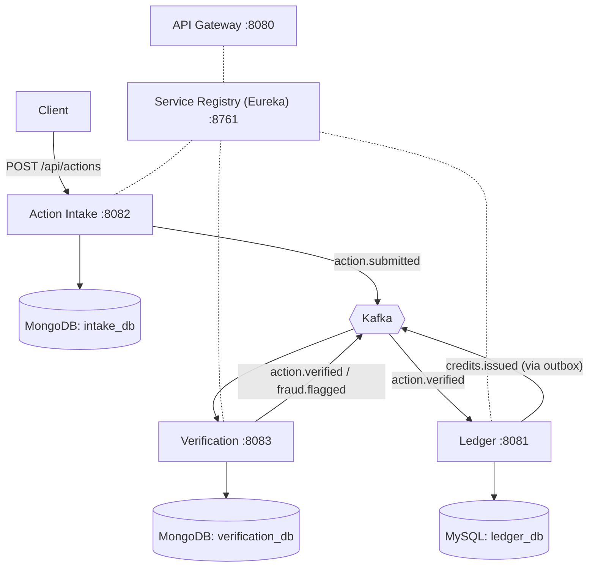

# Green Credits Platform

An event-driven microservices backend where people earn **credits** for verified environmental actions (recycling, e-waste handover, energy saved). Claims are checked by a fraud-detection service, and credits are issued through a **double-entry ledger** that never loses or duplicates a credit, even when services crash or messages are redelivered.

Built for the **Waste and Energy** track of an environment-themed problem statement (tracks: Air, Heat and Water, Waste and Energy).

> **Status: in progress.** The earn flow (claim, verify, issue credits) works end to end. Impact reporting, redemption, gateway routing/JWT, full Dockerization and AWS deployment are still to come. See the [Roadmap](#roadmap).

---

## Table of contents

1. [How it works](#how-it-works)
2. [Architecture](#architecture)
3. [Services](#services)
4. [Tech stack](#tech-stack)
5. [Events (Kafka contracts)](#events-kafka-contracts)
6. [Business rules (demo values)](#business-rules-demo-values)
7. [Ledger guarantees: four problems the posting logic prevents](#ledger-guarantees-four-problems-the-posting-logic-prevents)
8. [Key design decisions](#key-design-decisions)
9. [Getting started](#getting-started)
10. [API reference](#api-reference)
11. [Test cases](#test-cases)
12. [Useful commands](#useful-commands)
13. [Project structure](#project-structure)
14. [Known limitations](#known-limitations)
15. [Roadmap](#roadmap)

---

## How it works

1. A user submits a claim (for example "2 kg of plastic recycled, QR code `qr-100`") to **Action Intake**.
2. Intake saves the claim in MongoDB and publishes `action.submitted` to Kafka, then replies immediately.
3. **Verification** consumes the event and applies fraud rules. It publishes either `action.verified` (with the credits to issue) or `fraud.flagged`.
4. **Ledger** consumes `action.verified` and, in **one database transaction**, debits the issuer account, credits the user, writes the ledger entries and writes an outbox row.
5. An outbox relay publishes `credits.issued` to Kafka.

No service calls another service directly in this flow. They only exchange events.

## Architecture



Every service registers with the Eureka registry. The API gateway currently only registers itself; routing and JWT are planned.

## Services

| Service | Port | Responsibility | Storage |
|---|---|---|---|
| `registry-server` | 8761 | Eureka service registry | none |
| `api-gateway` | 8080 | Single entry point (routing and JWT planned) | none |
| `action-intake-service` | 8082 | Accepts claims, publishes `action.submitted` | MongoDB `intake_db` |
| `verification-service` | 8083 | Fraud rules, publishes `action.verified` or `fraud.flagged` | MongoDB `verification_db` |
| `ledger-service` | 8081 | Accounts, idempotent double-entry postings, credit issuing, outbox | MySQL `ledger_db` |

Verification has no REST API. Its only entry point is a Kafka listener.

## Tech stack

- Java 17+, Spring Boot 4
- Spring Web, Spring Data JPA (Hibernate), Spring Data MongoDB
- Spring for Apache Kafka (JSON events as strings, Jackson 3 `JsonMapper`)
- Spring Cloud Netflix Eureka (service discovery) and Spring Cloud Gateway
- MySQL 8.4 (money data), MongoDB 7 (claims and risk decisions), Apache Kafka 3.9 (KRaft mode, no ZooKeeper)
- Docker Compose for local infrastructure
- Lombok, springdoc OpenAPI / Swagger UI (ledger-service), JUnit 5

## Events (Kafka contracts)

All events are JSON. The message key is `userId`, so one user's events stay in order on one partition. Topics have 3 partitions.

| Topic | Produced by | Consumed by | Fields |
|---|---|---|---|
| `action.submitted` | Action Intake | Verification | `eventId`, `actionId`, `userId`, `actionType`, `quantity`, `qrToken`, `submittedAt` |
| `action.verified` | Verification | Ledger | `eventId`, `actionId`, `userId`, `credits` |
| `fraud.flagged` | Verification | (reserved for Impact service) | `eventId`, `actionId`, `userId`, `reason` |
| `credits.issued` | Ledger (outbox) | (reserved for Impact service) | `eventId`, `actionId`, `userId`, `credits`, `postingId` |
| `action.submitted.DLT` | Verification error handler | manual inspection | failed `action.submitted` messages |
| `action.verified.DLT` | Ledger error handler | manual inspection | failed `action.verified` messages |

`eventId` is derived from `actionId` (for example `action-verified-<actionId>`), so a re-published event carries the same ID. Consumers de-duplicate on `actionId`.

## Business rules (demo values)

These numbers are **demo assumptions**, not official conversion factors. They live in `ActionRules.java` in one place.

| Action type | Credits per unit | Max quantity per claim |
|---|---|---|
| `PLASTIC_RECYCLING` | 10 | 50 |
| `PAPER_RECYCLING` | 5 | 100 |
| `E_WASTE_HANDOVER` | 20 | 30 |
| `ENERGY_SAVED_KWH` | 2 | 500 |

Fraud rules, checked in this order:

| Rule | Flag reason |
|---|---|
| Action type not recognised | `UNKNOWN_ACTION_TYPE` |
| Quantity at most 0 or above the type's maximum | `QUANTITY_OUT_OF_RANGE` |
| User already has 5 or more claims in the last hour | `TOO_MANY_CLAIMS` |
| QR token already used by a different claim | `QR_TOKEN_REUSED` |

## Ledger guarantees: four problems the posting logic prevents

The ledger moves credits between accounts (credit and debit operations with an idempotency-key check). Every posting, whether it comes from `POST /api/postings` or from credit issuing after a verified claim, is designed to prevent four classic money-movement bugs.

| Problem | Example | Prevented by | Proven by |
|---|---|---|---|
| **Invalid transfers** | Zero or negative amount, same sender and receiver, missing account | Input checks and a balance check, each with a specific error code | [Test cases](#test-cases) group A, rows 4 and 6 to 9 |
| **Concurrent transfers** | Two requests spend the same balance at the same moment | Row locks on both accounts, taken in a fixed order | Automated test B3 (100 parallel spends) |
| **Duplicate transfers** | A client retries a request and the credits move twice | Unique idempotency key, checked after the locks | Group A rows 2 and 3, automated test B2 |
| **Partial transfers** | Credits leave one account but never arrive in the other | One database transaction around every step | Automated test B1 and the `SUM(balance) = 0` check |

### 1. Invalid transfers

Bad requests are rejected with a clear status code before they can change any balance.

| Bad input | Response |
|---|---|
| Amount of zero or less | `400` |
| Same account as sender and receiver | `400` |
| Missing, blank or over-long `Idempotency-Key` (more than 100 characters) | `400` |
| Sender or receiver account does not exist | `404` |
| User account without enough credits | `422` |

The `SYSTEM` issuer account is the only account allowed to go negative, and its negative balance equals the total credits issued. Input checks run before any database work. The balance check runs inside the transaction **after** the account rows are locked, so it always sees the true balance.

### 2. Concurrent transfers

**The bug:** two requests both read a balance of 500, both spend 500, and the account ends at -500.

**The fix:** inside one transaction the ledger locks both account rows with `SELECT ... FOR UPDATE` (a pessimistic write lock). A second request touching the same accounts waits until the first commits, then reads the updated balance. The rows are always locked in ascending ID order, so two opposite transfers (A to B and B to A at the same time) cannot deadlock.

**Proof:** a test fires 100 parallel spends of 10 against a balance of 500. Exactly 50 succeed, 50 are rejected with `422`, and the balance ends at exactly 0, never negative.

### 3. Duplicate transfers

**The bug:** a client times out, retries the same request, and the credits move twice.

**The fix:** every posting carries a unique `Idempotency-Key`.

- The key is checked **after** the locks are taken, so two simultaneous requests with the same key cannot both pass the check.
- A retry with the same key and the same request returns `200` with the original `postingId`, and nothing moves.
- The same key with a different request returns `409`.
- A unique constraint on the key column is the last line of defence. If two requests somehow got past the check, the database rejects the second.
- For credits issued from Kafka events, the key is `earn-<actionId>`, so a redelivered `action.verified` event can never pay twice.

**Proof:** a test sends the same key 20 times at once. The credit is applied exactly once and all 20 callers receive the same posting. Replaying the entire `action.verified` topic leaves every balance unchanged.

### 4. Partial transfers

**The bug:** the sender is debited, the service crashes, and the receiver is never credited.

**The fix:** everything for one posting happens in a **single database transaction**: the debit, the credit, the posting row, the two ledger entries and the outbox event. If any step fails, the whole transaction rolls back and no balance changes. The ledger is double-entry (every `DEBIT` has a matching `CREDIT`), and entries are only ever inserted, never updated or deleted.

**Proof:** after 100 parallel credits the totals still sum to zero and exactly 100 ledger entries exist. At any time, `SELECT SUM(balance) FROM accounts;` must return `0`.

## Key design decisions

- **Credits are whole numbers (`long`).** Never floating point.
- **Double-entry ledger.** Every posting writes one DEBIT and one CREDIT entry. Entries are only ever inserted. A `SYSTEM` issuer account is the source of all credits, so the sum of all balances is always `0`.
- **Row locking in a fixed order.** Both account rows are locked with `SELECT ... FOR UPDATE`, always in ID order, so concurrent postings are serialised and cannot deadlock on opposite transfers.
- **Idempotency keys.** Each posting carries a unique `Idempotency-Key`. The key is checked after the locks are taken, and a unique database constraint is the last line of defence. A replay returns the original result instead of posting again.
- **Credit issuing is idempotent by `actionId`.** The posting key is `earn-<actionId>`, so a redelivered `action.verified` can never pay twice.
- **Transactional outbox (ledger).** The `credits.issued` event is saved in the same database transaction as the posting. A relay publishes it to Kafka, so an event cannot be lost between "credits issued" and "event sent".
- **Outbox-style retry (MongoDB services).** Intake and Verification save first (`published = false`), then publish, and a scheduled job retries anything unpublished. Duplicate publishes are possible and are handled by idempotent consumers.
- **Idempotent consumers.** Verification uses the `actionId` as the document ID of each decision, so a redelivered event is not decided twice.
- **Race-free QR check.** The QR token is the `_id` of a MongoDB document, so only one claim can ever insert it.
- **Dead-letter topics.** A message that keeps failing is retried 3 times (1 second apart) and then moved to a `.DLT` topic, so one bad message cannot block a partition.
- **JSON as strings on Kafka.** Services share a data contract (the JSON fields), not Java classes.

## Getting started

### Prerequisites

- JDK 17 or newer
- Docker Desktop
- Git
- (optional) IntelliJ IDEA and Postman

### 1. Clone and start the infrastructure

```bash
git clone https://github.com/Riya2309ai/green-credits-platform.git
cd green-credits-platform
docker compose up -d
docker ps
```

You should see `gc-mysql` (port 3307), `gc-kafka` (9092) and `gc-mongo` (27017). The credentials in `docker-compose.yml` are for **local development only**.

### 2. Start the services, in this order

1. `registry-server`
2. `action-intake-service`
3. `verification-service`
4. `ledger-service`
5. `api-gateway` (optional for now)

From IntelliJ, run each `*Application` class. From a terminal, run this inside each service folder:

```bash
./mvnw spring-boot:run          # Mac / Linux
mvnw.cmd spring-boot:run        # Windows
```

Kafka topics are created automatically by the services on startup. The issuer account (`green-issuer`) and user accounts are created automatically by the ledger the first time they are needed.

### 3. Check everything is up

- Eureka dashboard: http://localhost:8761 (each service should be listed)
- Ledger Swagger UI: http://localhost:8081/swagger-ui/index.html

## API reference

### Action Intake (`:8082`)

| Method | Path | Description |
|---|---|---|
| `POST` | `/api/actions` | Submit a claim. Returns `201` with the stored claim |
| `GET` | `/api/actions/{id}` | Get a claim by its MongoDB id. `404` if unknown |

```bash
curl -X POST http://localhost:8082/api/actions \
  -H "Content-Type: application/json" \
  -d '{"userId":"user-1","actionType":"PLASTIC_RECYCLING","quantity":2,"qrToken":"qr-001"}'
```

(On Windows PowerShell use `curl.exe`, or use Postman or Swagger.)

`actionType` is one of `PLASTIC_RECYCLING`, `PAPER_RECYCLING`, `E_WASTE_HANDOVER`, `ENERGY_SAVED_KWH`. Intake returns `201` for any well-formed claim. The fraud decision is made afterwards by Verification.

### Ledger (`:8081`)

| Method | Path | Description |
|---|---|---|
| `POST` | `/api/accounts` | Create an account (`{"ownerId": "...", "type": "USER" or "SYSTEM"}`). `409` if it exists |
| `GET` | `/api/accounts/{id}` | Get an account and its balance |
| `POST` | `/api/postings` | Move credits between two accounts. Requires an `Idempotency-Key` header |

Posting body: `{"fromAccountId": 1, "toAccountId": 2, "amount": 500}`

| Posting response | Meaning |
|---|---|
| `201` | New posting created |
| `200` | Same `Idempotency-Key` and same request: the original result is returned |
| `409` | Same `Idempotency-Key` used with a different request |
| `422` | Insufficient credits |
| `404` | Account not found |
| `400` | Missing header, amount at most 0, or same account on both sides |

## Test cases

### A. Ledger API (manual, via Swagger or Postman)

Create one `SYSTEM` account (**S**) and two `USER` accounts (**U1**, **U2**), then call `POST /api/postings`:

| # | Idempotency-Key | Body | Expected |
|---|---|---|---|
| 1 | `credit-001` | S to U1, amount 500 | `201` |
| 2 | `credit-001` | same body | `200`, same `postingId` |
| 3 | `credit-001` | amount 999 | `409` |
| 4 | `send-001` | U1 to U2, amount 600 | `422` |
| 5 | `send-002` | U1 to U2, amount 200 | `201` |
| 6 | (no header) | any valid body | `400` |
| 7 | `x-1` | from account 999 | `404` |
| 8 | `x-2` | amount 0 | `400` |
| 9 | `x-3` | U1 to U1 | `400` |

After tests 1, 2 and 5: U1 balance is `300`, U2 is `200`, S is `-500`, and the three sum to `0`.

### B. Automated concurrency tests

`ledger-service/src/test/.../PostingConcurrencyTest.java` (needs MySQL from Docker Compose running):

| # | Test | What it proves |
|---|---|---|
| B1 | 100 parallel credits of 10 | No lost updates: user ends at 1000, issuer at -1000, totals sum to 0, 100 ledger entries exist |
| B2 | Same `Idempotency-Key` sent 20 times at once | The credit is applied exactly once and all callers get the same posting |
| B3 | 100 parallel spends of 10 against a balance of 500 | Exactly 50 succeed, 50 are rejected, balance ends at exactly 0 and never goes negative |

```bash
cd ledger-service
./mvnw test            # Windows: mvnw.cmd test
```

### C. End-to-end earn flow (Intake, then Verification, then Ledger)

Send each claim to `POST http://localhost:8082/api/actions`. Intake returns `201` every time, so check the outcome in MongoDB, Kafka or MySQL (see [Useful commands](#useful-commands)). Use fresh `userId` and `qrToken` values for each run.

| # | Claim | Expected outcome |
|---|---|---|
| 1 | `user-31`, `PLASTIC_RECYCLING`, 2, `qr-401` | `action.verified` with `credits: 20`, then 20 credits in the user's ledger account |
| 2 | same body again | `fraud.flagged` with `QR_TOKEN_REUSED`, no credits issued |
| 3 | `user-31`, `PLASTIC_RECYCLING`, 500, `qr-402` | `fraud.flagged` with `QUANTITY_OUT_OF_RANGE` |
| 4 | six claims for `user-32`, each with a new `qrToken` | first five verified (5 credits each for `PAPER_RECYCLING`, quantity 1), sixth flagged `TOO_MANY_CLAIMS` |
| 5 | `user-40`, `PLASTIC_RECYCLING`, 3, `qr-700` | 30 credits in `user-40`'s ledger account and a `credits.issued` event |

Ledger invariant to check after any of the above: `SELECT SUM(balance) FROM accounts;` must be `0`.

### D. Resilience checks

| Scenario | Steps | Expected |
|---|---|---|
| Kafka down while a claim arrives | Stop `gc-kafka`, submit a claim, start `gc-kafka` again | The claim is saved with `published: false`, and flips to `true` within about a minute. The claim is not lost |
| Consumer down | Stop `verification-service`, submit two claims, start it again | Both claims are decided after restart |
| Bad message | A non-JSON message on `action.submitted` | Retried 3 times, then appears in `action.submitted.DLT`. Other messages keep flowing |
| Replay the whole topic | Stop `ledger-service`, reset its consumer group offsets to earliest, start it again | Every `action.verified` event is delivered again, but all balances are unchanged, `SUM(balance)` is still `0`, and no new outbox rows appear |

Reset command for the replay check:

```bash
docker exec gc-kafka /opt/kafka/bin/kafka-consumer-groups.sh --bootstrap-server localhost:9092 \
  --group ledger-service --topic action.verified --reset-offsets --to-earliest --execute
```

## Useful commands

```bash
# Ledger accounts and balances
docker exec -it gc-mysql mysql -uledger -pledgerpass ledger_db -e "SELECT id, owner_id, type, balance FROM accounts;"

# The ledger must balance (expect 0)
docker exec -it gc-mysql mysql -uledger -pledgerpass ledger_db -e "SELECT SUM(balance) FROM accounts;"

# Outbox rows (sent should be 1)
docker exec -it gc-mysql mysql -uledger -pledgerpass ledger_db -e "SELECT id, topic, message_key, sent FROM outbox_events;"

# Fraud decisions
docker exec -it gc-mongo mongosh verification_db --eval "db.risk_assessments.find({}, {userId:1, decision:1, reason:1, credits:1}).pretty()"

# Stored claims
docker exec -it gc-mongo mongosh intake_db --eval "db.actions.find().pretty()"

# Watch a topic (replace the topic name)
docker exec -it gc-kafka /opt/kafka/bin/kafka-console-consumer.sh --topic action.verified \
  --from-beginning --property print.key=true --bootstrap-server localhost:9092

# List topics
docker exec gc-kafka /opt/kafka/bin/kafka-topics.sh --list --bootstrap-server localhost:9092

# Reset everything (deletes all local data)
docker compose down -v
```

## Project structure

```
green-credits-platform/
├── docker-compose.yml          MySQL, Kafka, MongoDB for local development
├── registry-server/            Eureka service registry
├── api-gateway/                Spring Cloud Gateway (routing and JWT planned)
├── ledger-service/             accounts, postings, credit issuing, outbox
├── action-intake-service/      claim intake, Kafka producer
├── verification-service/       fraud rules, Kafka consumer and producer
└── docs/                       architecture diagram (to add)
```

## Known limitations

- The API gateway does not route requests or authenticate yet. Services are called directly on their own ports.
- Intake does not learn the verification result, so a flagged claim still shows status `SUBMITTED` there.
- Schema changes are applied by Hibernate (`ddl-auto: update`), which is fine locally but not for production. Flyway migrations are planned before deployment.
- MongoDB runs as a single node without a replica set, so there are no multi-document transactions. Each MongoDB write here touches one document, which is atomic.
- Verification checks QR tokens for reuse only. It does not verify that a token was genuinely issued by a collection point, and there is no geolocation check.
- Docker Compose credentials are local-development values.
- No performance numbers yet. Load testing is on the roadmap.

## Roadmap

- [x] Eureka service registry and API gateway skeleton
- [x] Ledger service: accounts, double-entry postings, idempotency keys, row locking
- [x] Concurrency tests for the ledger
- [x] Swagger UI for the ledger
- [x] Kafka and MongoDB in Docker Compose
- [x] Action Intake service (MongoDB, Kafka producer, retry of unpublished events)
- [x] Verification service (fraud rules, dead-letter topic)
- [x] Ledger consumes `action.verified`, issues credits through a transactional outbox
- [ ] Impact service: listens to `credits.issued` and `fraud.flagged`, builds reporting totals
- [ ] Redeem service: spend credits through an atomic ledger debit
- [ ] Gateway routes and JWT login
- [ ] Dockerfiles for every service and a full `docker compose up`
- [ ] Flyway migrations
- [ ] Integration tests with Testcontainers and GitHub Actions CI
- [ ] Load test (k6) with throughput and p95 latency
- [ ] Deployment on AWS (EC2 with Docker Compose, MongoDB Atlas free tier)
- [ ] Architecture diagram image in `docs/`

## Author

Riya Sharma · [GitHub](https://github.com/Riya2309ai) · [LinkedIn](https://linkedin.com/in/riya-sharma-2a4b0713b)
